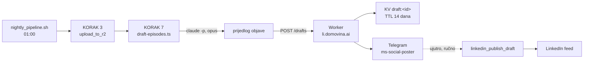

# Prijedlozi objava: nightly piše, ti objavljuješ

Zapisano 2026-09-17, na dan kad je prvi draft sjeo u grupu. Ovdje je **zašto**
lanac izgleda baš ovako i koje su odluke već donesene, da ih ne treba
premišljati. Za ono što servis radi vidi [`../README.md`](../README.md), za
sloj obavijesti [`2026-08-27-telegram-obavijesti.md`](2026-08-27-telegram-obavijesti.md).

## Problem

Nightly u `fetch.domovina.tv` svake noći dovuče nove epizode, transkribira ih,
napiše članak i digne ih na domovina.ai. Do jutros je to znao samo pipeline.
Objava na LinkedIn bila je zaseban posao koji se radi kad se sjetiš, a sjetiš se
rijetko, pa su epizode odlazile u arhivu bez ijedne rečenice izvan platforme.

Automatsko objavljivanje nije rješenje. Post nosi tvoje ime i tvrdnju o tome što
je netko rekao, a model zna imenovati sudionika iz općeg znanja (incident
atribucije od 2026-07-29). Zato je odluka: **stroj piše, čovjek objavljuje**.

## Lanac



Skripta živi u `linkedin-poster`, ne u pipeline repou, jer sve što zna je
LinkedIn briga: glas, linter, bearer token, grupa. Iz pipelinea čita samo
izlazni direktorij.

## Tri ograde za "nova epizoda"

Svaka postoji jer je jeftinija provjera sama za sebe kriva:

| Ograda | Što traži | Zašto bez nje ne ide |
|---|---|---|
| 1. prozor | `*.wav.canary.summary.json` mlađi od 30 h | Bez njega prvi run drafta godine unatrag. |
| 2. članak | `*.article.json` pokraj sažetka | Sam sažetak znači da je AI sloj stao na pola, stranica epizode bi bila tanka. |
| 3. CDN | `cdn.domovina.ai/data/{id}/article.json` vraća 200 | Disk nije proizvod. Epizoda koja nije uploadana nije na domovina.ai, a objava koja vodi na 404 gora je od objave koja kasni dan. |

Epizoda koja padne na trećoj ogradi **nije** zapisana u stanje, pa je sljedeći
nightly pokupi bez ikakve intervencije. Isto vrijedi za grešku modela i za
odgodu `claude-window` arbitra.

## Stanje: zašto datoteka, a ne KV

`.state/drafted.json` u ovom repou (gitignoriran) drži popis već draftanih
YouTube ID-eva. Moglo je i u KV, ali odluka je namjerna: stanje pripada **mašini
koja vrti nightly**, a ne servisu. Worker koji izgubi KV ne smije prouzročiti
poplavu od pedeset objava, a lokalna datoteka preživi svaki redeploy.

Prvi run na stroju s arhivom: `npm run drafts -- --seed` upiše sve iz prozora
kao obrađeno i ne napiše ni riječ.

## Kvota i `claude-window`

Nightly korak ide uz `CLAUDE_WINDOW_GUARD=1`, isto kao koraci 7 i 8 pipelinea.
Razlog je isti: nightly ima dugačak rep (6 h 37 min, 14.8.), a poziv koji bi
otvorio svjež petosatni prozor tik prije jutra pojeo bi dnevnu kvotu. Arbitar
odbija takav poziv, skripta prekine petlju, a epizode ostanu za sljedeću noć.

Model je Opus (`DRAFT_MODEL`), s jednim ponovnim pokušajem ako tekst dođe s
crticom ili markdownom. Drugi pokušaj ne postoji: Worker ionako lintira tekst i
presuda stoji u poruci pokraj drafta.

## Što stiže u grupu

Dvije poruke po epizodi:

1. **Draft** - kanal, naslov, cijeli tekst u `<pre>` bloku (na mobitelu tap =
   kopiraj), link na epizodu, broj znakova, presuda lintera i ID drafta. Bez
   previewa.
2. **Kartica** - samo link, s uključenim previewom, da se vidi kako se
   `og:title`, `og:description` i `og:image` (1200x630,
   `cdn.domovina.ai/images/{id}/og-share.jpg`) stvarno resolvaju.

Razdvojeno je namjerno. Poruka s draftom postoji da bi se kopirala, a velika
Open Graph kartica u istom balončiću gura tekst gore i zamuti što se točno
kopira. Ovako svaka poruka radi jedan posao.

Kartica je ujedno jedina iznimka od pravila da su previewi ugašeni. Ugašeni su
jer Telegram povuče svaki link koji prikazuje, a prefetch linka za obnovu tokena
potrošio bi jednokratni nonce prije nego ga itko takne. Zato `sendTelegram`
prima `previewUrl`, a `notify` ga postavlja samo za `kind: "draft_link"`.

### Poglavlja ispod drafta (od 2026-10-14)

Nakon kartice slijede sva poglavlja epizode, svako kao zasebna poruka:
`⏱ 5:20 · naslov` pa link `domovina.ai/v/{id}/t/{sek}` s velikim previewom
tog trenutka (`og-t-{sek}.jpg`). Isti obrazac kao `share_to_whatsapp.js` u
`fetch.domovina.tv`, koji je 08.10. poslao Grmoju #114 Ivanu Orloviću; ovdje
nije trebala zakrpa mosta jer Telegram og-tagove resolva sam.

Odluke i zašto:

- **Petlja je na Macu, ne u Workeru.** Worker ima `POST /drafts/{id}/chapters`
  koji šalje JEDNO poglavlje i odgovara tek kad ga Telegram primi. Epizoda ima
  30-46 poglavlja, a grupa prima ~20 poruka u minuti od jednog bota, pa run traje
  2-3 minute; `waitUntil` nakon odgovora runtime reže na 30 s. Usput, jedan
  request po poglavlju drži broj subrequestova po pozivu na jedan.
- **Razmak 3,5 s** (`--chapter-delay`). Ispod limita grupe, s mjestom za draft.
  Na 429 `sendTelegram` ionako poštuje `retry_after`.
- **Tihe poruke** (`disable_notification`). Zvoni draft, ne 36 poglavlja.
- **Poglavlja s CDN-a**, ne s diska: link mora voditi na timestamp koji živa
  stranica ima. Pravila izvlačenja kopirana iz `extractChapters` u WhatsApp
  skripti (sve sekcije svih iteracija, sortirano, prva pobjeđuje na istoj sekundi).
- **Stanje u `.state/drafted.json` pod `chapters[id].sent`**, zapisuje se poslije
  svake uspješne poruke. Na prvoj grešci petlja staje, rerun dopunjava; nema rupa
  ni duplikata.
- **5 s pauze nakon `POST /drafts`**, jer Worker objavi draft tek nakon što odgovori
  (`waitUntil`); bez pauze bi prvo poglavlje znalo stići iznad drafta.

Ručno, za jednu epizodu: `npm run drafts -- --id VIDEOID --chapters-only`.
Prvi put 2026-10-14 za `ja995FNQP3A` (Petar Šarić #115): 36/36.

Objava je onda u Claude Codeu:

```
linkedin_drafts                       # što čeka
linkedin_draft S5bScs9QuOk            # cijeli tekst, za uređivanje
linkedin_publish_draft S5bScs9QuOk    # objavi, kakav jest ili s novim tekstom
linkedin_discard_draft S5bScs9QuOk    # baci
```

Draft se briše tek kad LinkedIn prihvati objavu. Odbijenica ostavlja tekst na
mjestu, pa sljedeći pokušaj ne kreće od nule.

Jutarnji sažetak (cron, 09:00 UTC) od sada nabraja draftove koji čekaju. To je
druga polovica ograde: poruka u 02:00 se prespava, popis u 09:00 ne.

## Zamke plaćene ovdje

**Kanalski direktoriji su symlinkovi** na `/Volumes/DOMOVINA2TB`. `readdir` s
`withFileTypes` ih ne prijavljuje kao direktorije, pa obilazak mora ići preko
`statSync` (koji slijedi link), inače skripta uredno nađe nula epizoda.

**`_yt_` se uzima kao zadnji pogodak** u imenu datoteke. Naslovi epizoda znaju
sadržavati taj niz, pa bi prvi pogodak izvukao krivi ID. Ista zamka već je
zapisana u pipelineu (`extract-video-id-last-match`).

**Draft ID je YouTube ID.** Time je cijeli lanac idempotentan: ponovni run iste
epizode prepiše vlastiti draft umjesto da napuni grupu kopijama.

**Ništa na ovom putu ne može objaviti.** `POST /drafts` sprema i javi; jedini
put do Linkedina je ručni poziv. To je zapisano i u komentaru rute, jer je
jedina stvar koju ne smije "popraviti" netko tko kasnije doda automatizaciju.
